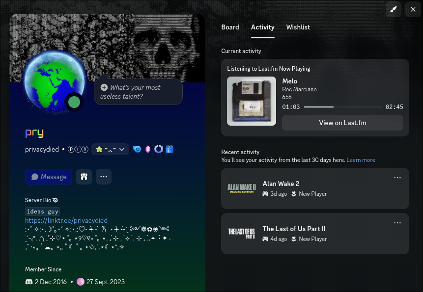

# fmpresence

[](https://github.com/privacydied/fmpresence/actions/workflows/tests.yml)

Shows what you are playing as a Discord Rich Presence (**Listening to …**).

It has two sources:

- **Plex** (recommended for Plex users): reads your Plex Media Server session
  directly. A websocket tells it about play, pause, seek and stop as they
  happen, so the presence updates at once and the progress is exact.
- **Last.fm**: works with any player that sends **now playing** to Last.fm.

When both are configured, Plex is checked first. Last.fm is used only when
nothing is playing on Plex.

It runs as a `systemd --user` service. It talks to the Discord desktop client
through the local IPC socket. It does not need a Discord bot or a token.



## What it shows

- Track title and artist. The member list shows the **track title** (change
  this with `STATUS_DISPLAY`).
- Album art, with the album name on hover. See [Album art](#album-art).
- A progress bar
- A **Listen** button that opens a [song.link](https://song.link) page with
  links to Spotify, Apple Music, YouTube, Tidal and others. It is shown only
  when the track is found in the Apple Music catalogue.
- A **View on Last.fm** button
- Optional: movies and TV episodes as **Watching …** (`SHOW_VIDEO=1`)

When nothing is playing, the presence is cleared. When Plex is paused, the
presence is also cleared, unless you set `SHOW_PAUSED=1`.

Discord shows the buttons to other people, not to you.

## How it works

1. **Plex:** it reads `/status/sessions` and takes the session of your Plex
   user. A Plex websocket (`/:/websockets/notifications`) wakes it on every
   playback change. While the websocket is connected, it also polls every 30
   seconds as a safety check. Without the websocket, it polls every
   `POLL_SECONDS`.
2. **Last.fm:** if Plex has nothing, it calls `user.getRecentTracks` with
   `limit=1`, at most every `LASTFM_POLL_SECONDS` (default 30). It uses the
   newest track only if it has the `nowplaying` flag.
3. **Links and art:** it searches the iTunes catalogue for the track. It
   accepts a result only if the title and artist match. The track ID gives the
   song.link page, and the result also gives album art.
4. It sends an update to Discord when the presence changes, and again every 30
   seconds so the presence comes back after a Discord restart.

The progress bar stays steady between updates. It moves when you seek, and it
starts again when the same track plays again.

> **Note for Plex users:** Plex's built-in Last.fm scrobbler sends only
> finished scrobbles, not "now playing". With Plex, use the Plex source.

Error handling:

- **Discord is not running:** it tries to connect again on the next update.
- **The websocket drops:** it polls until the websocket reconnects.
- **All sources fail:** it waits longer after each failure (exponential backoff,
  maximum 5 minutes).
- **Config is missing:** it exits with code 2. systemd does not restart it.

## Album art

Discord loads presence images from public URLs. A Plex server on your home
network is not public, so fmpresence uses the first of these that works:

1. **Your own Plex cover**, through the art proxy, if `ART_BASE_URL` is set.
   This gives the correct cover for every track, including your own rips.
2. **Apple Music** cover from the iTunes search
3. **Last.fm** album cover (needs `LASTFM_API_KEY`)

If none of these has a cover, the presence is shown without an image.

### Art proxy (optional)

`fmpresence serve-art` is a small HTTP server that serves Plex covers. Run it on
a machine that can reach Plex, and make it reachable from the internet through
your reverse proxy (for example `https://art.example.com` → `http://host:8765`).

It serves only signed URLs. The main service signs each cover path with
`ART_SECRET`, and the proxy refuses everything else. The proxy also accepts
only Plex library image paths, even when the signature is valid. Your Plex
token never appears in a URL.

```bash
# on the machine next to Plex (Python 3.8+, standard library only)
PLEX_URL=http://localhost:32400 PLEX_TOKEN=... ART_SECRET=long-random-string \
  python3 fmpresence.py serve-art
```

Then add the same secret and the public URL to the env file of the main service:

```ini
ART_BASE_URL=https://art.example.com
ART_SECRET=long-random-string
```

To make a secret: `python3 -c "import secrets; print(secrets.token_urlsafe(32))"`.

## Requirements

- Linux with the Discord desktop client running. The IPC socket is at
  `$XDG_RUNTIME_DIR/discord-ipc-0`.
- In Discord, **Settings → Activity Privacy → Share my activity** must be on.
- Python 3.10 or later and [uv](https://docs.astral.sh/uv/)
- A Discord application ID
- For the Plex source: your Plex server URL and a Plex token
- For the Last.fm source: a Last.fm API key, and a player that sends **now
  playing** to Last.fm. To check, play a track and look at your Last.fm
  profile. It must show "Scrobbling now".

## Setup

### 1. Install

As a uv tool:

```bash
uv tool install git+https://github.com/privacydied/fmpresence
```

Or from a clone:

```bash
git clone https://github.com/privacydied/fmpresence.git
cd fmpresence
uv sync
```

In a clone, run the commands below as `uv run fmpresence …`.

### 2. Get credentials

- **Discord application ID:** open <https://discord.com/developers/applications>,
  click **New Application**, and copy the **Application ID**. The application
  name is the text after "Listening to", so give it a name like `Plex`.
- **Plex token:** in Plex Web, open any item, select **⋯ → Get Info → View
  XML**, and copy the `X-Plex-Token=` value from the URL. On the server, the
  token is also the `PlexOnlineToken` attribute in `Preferences.xml`.
- **Last.fm API key:** create one at <https://www.last.fm/api/account/create>.
  You only need the API key. You do not need the shared secret.

### 3. Install the service

```bash
fmpresence install
```

This command:

- writes an env template to `~/.config/fmpresence/env` (mode 600) if the file
  does not exist,
- writes `~/.config/systemd/user/fmpresence.service`,
- enables and starts the service.

Fill in the env file, then restart the service:

```bash
systemctl --user restart fmpresence
journalctl --user -u fmpresence -f
```

To remove the service: `fmpresence uninstall`. This keeps your env file.

### 4. Configure

```ini
DISCORD_CLIENT_ID=123456789012345678
PLEX_URL=http://your-plex-server:32400
PLEX_TOKEN=your_plex_token
LASTFM_USER=your_lastfm_username
LASTFM_API_KEY=your_api_key
POLL_SECONDS=15
# HIDE_ARTISTS=Artist One|Artist Two
```

| Variable              | Default | Purpose |
|-----------------------|---------|---------|
| `DISCORD_CLIENT_ID`   | (required) | Discord application ID |
| `PLEX_URL`            | \*      | Plex server URL, for example `http://host:32400` |
| `PLEX_TOKEN`          | \*      | Plex token |
| `PLEX_USER`           | token owner | Plex username whose session is shown |
| `PLEX_WEBSOCKET`      | `1`     | `0` turns off the websocket (polling only) |
| `LASTFM_USER`         | \*      | Last.fm username |
| `LASTFM_API_KEY`      | \*      | Last.fm API key (also used for album art) |
| `POLL_SECONDS`        | `15`    | Poll interval without the websocket (minimum 5) |
| `LASTFM_POLL_SECONDS` | `30`    | Poll interval for Last.fm |
| `STATUS_DISPLAY`      | `details` | What the member list shows: `details` (track), `state` (artist) or `name` (app name) |
| `SHOW_PAUSED`         | `0`     | `1` keeps the presence while Plex is paused |
| `SHOW_VIDEO`          | `0`     | `1` also shows movies and TV episodes from Plex |
| `LINKS`               | `1`     | `0` turns off the iTunes lookup and the **Listen** button |
| `ITUNES_COUNTRY`      | `us`    | iTunes store country used for the lookup |
| `HIDE_ARTISTS`        |         | Artists to hide, separated by `\|` |
| `HIDE_ALBUMS`         |         | Albums to hide, separated by `\|` |
| `HIDE_TRACKS`         |         | Track titles to hide, separated by `\|` |
| `HIDE_LIBRARIES`      |         | Plex libraries to hide, separated by `\|` |
| `ART_BASE_URL`        |         | Public URL of the art proxy |
| `ART_SECRET`          |         | Shared secret for the art proxy |
| `ART_LISTEN`          | `0.0.0.0:8765` | Address and port for `serve-art` |
| `APP_NAME`            |         | Replaces the application name in "Listening to <name>" |
| `SPOTIFY_ICON`        | `0`     | `1` adds a small Spotify icon. Discord puts it on the album art, bottom right |
| `SPOTIFY_ICON_URL`    | grey logo in `assets/` | Public image URL for that icon |
| `LOG_LEVEL`           | `INFO`  | Python log level |

\* You need at least one source: `PLEX_URL` with `PLEX_TOKEN`, or
`LASTFM_USER` with `LASTFM_API_KEY`.

The hide lists use `|` as the separator, because artist and album names often
contain commas. Matching ignores case, accents and punctuation. For a track
with more than one artist, the track is hidden if any of its artists is in
`HIDE_ARTISTS`. Plex does not report which playlist a track comes from, so
playlists cannot be hidden.

## Development

```bash
uv sync
uv run pytest
```

The tests run offline. They use real API responses that are saved in
`tests/fixtures/`.

## Troubleshooting

| Symptom | Cause and fix |
|---------|---------------|
| `need DISCORD_CLIENT_ID plus …` and the service stops | A required variable in `~/.config/fmpresence/env` is empty. |
| `plex: HTTP Error 401` | The Plex token is wrong or expired. |
| Plex plays but nothing shows | The session belongs to a different Plex user. Set `PLEX_USER` to the username in the Plex session. |
| `last.fm …: Invalid API key` | The API key is wrong. Check `LASTFM_API_KEY`. |
| It runs but Discord shows nothing | Turn on **Share my activity** in Discord. Check that the Discord desktop client is running (the browser version has no IPC). |
| It never shows a track (Last.fm source) | Your player does not send "now playing" to Last.fm. Check your Last.fm profile while a track plays. Plex users: use the Plex source. |
| No **Listen** button | The track is not in the Apple Music catalogue, or the match was not exact enough. |
| `no album art found for …` | No source has a cover. Set up the [art proxy](#art-proxy-optional) to use your Plex covers. |
| Updates take up to `POLL_SECONDS` | The websocket is not connected. Look for `plex websocket connected` in the log. |
